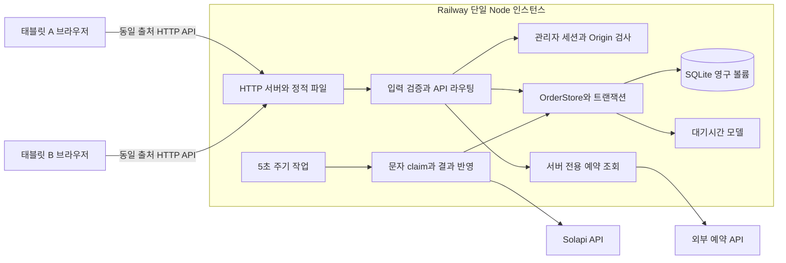
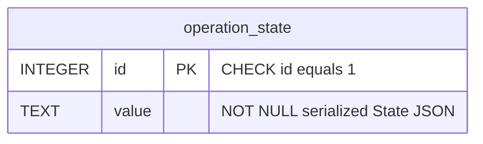
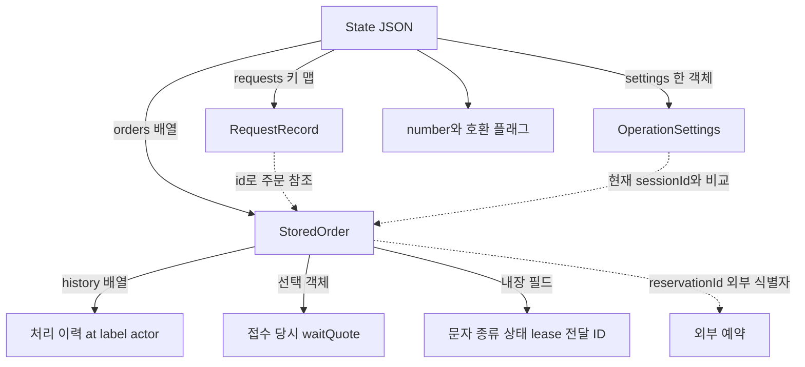
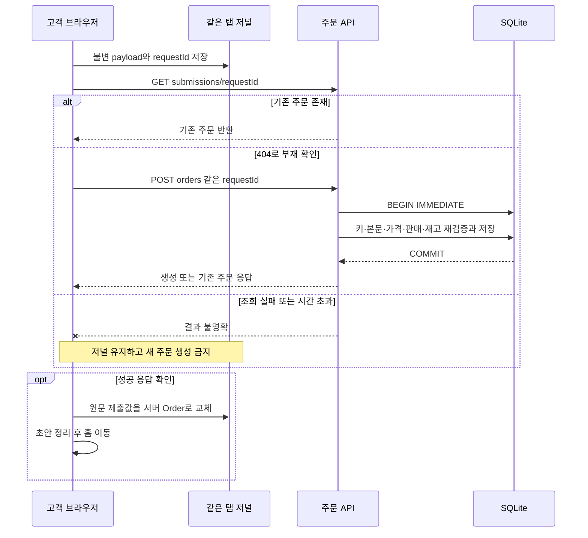
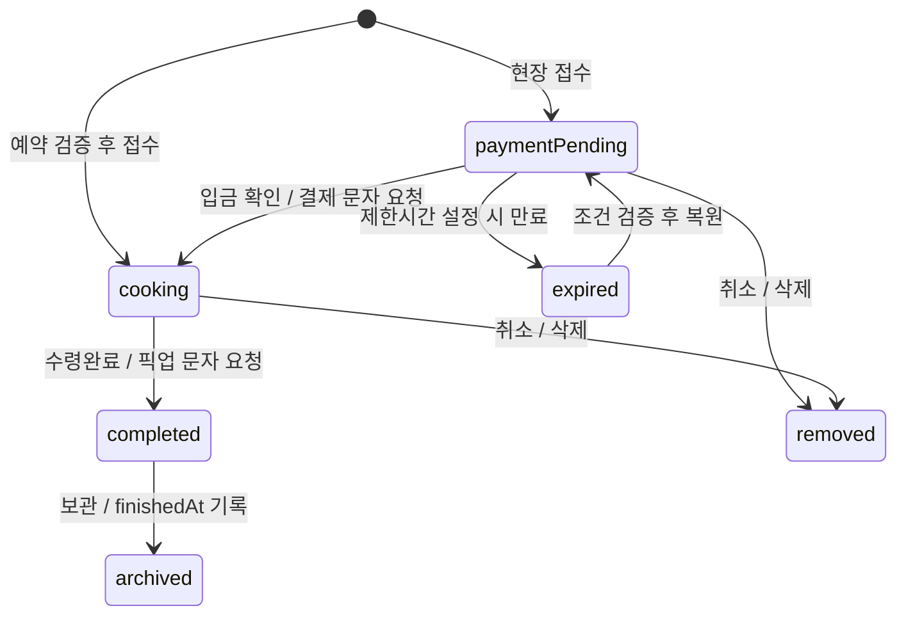
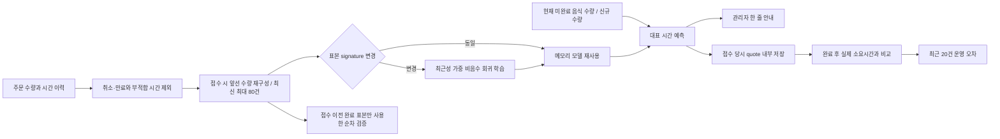

# 기술 구조와 현재 구현 종합

기준: 2026-11-26 저장소 `da381a3`. **소스 구현 설명**이며 11월 변경 일부는 운영 서버에 미배포다. 실제 적용 구분과 운영 결과는 [전체 운영 기록](operations-record.md), 배포 절차는 [운영 절차](deployment-runbook.md)를 참고한다.

이 문서의 11월 소스 변경은 운영 이후 실제 사용 흐름과 코드를 대조해 발견한 개선을 구현한 것이다. 운영 중 피드백에 따른 고객 UI·재발송·연락처·상태·예측 개선과 사후 구조 개선의 문제·원인·조치는 [실제 운영 경험 분석](field-operation-changes.md)에 정리했다. 현장에서 효과를 측정한 변경과 소스 검증만 완료한 변경은 구분한다.

현재 선택의 대안·장단점, 실패 지점별 처리, 업무 불변 조건과 실제 테스트 이름의 연결, 운영 수치 재현은 [기술 선택·검증 근거](engineering-decisions.md)에 정리했다. 당시 결정 이유를 입증할 기록이 없는 부분은 사후 평가로 표시한다.

## 구성과 요청 경로

이 문서의 도식은 코드 기준으로 작성한 GitHub Mermaid다. 실제 테이블·제약과 JSON 내부의 논리 구조를 구분하며, 아직 구현하지 않은 정규화 테이블을 현재 ERD로 표시하지 않는다.

### 런타임 아키텍처



태블릿은 각각 독립된 브라우저 상태를 가진다. 데이터의 최종 기준은 공통 서버·DB이며 기기끼리 직접 동기화하지 않는다. 관리자 세션과 모델 캐시는 메모리, 주문·요청 키·문자 작업 정보는 SQLite, 미확정 고객 제출은 같은 탭의 sessionStorage에 위치한다. 외부 예약 서비스의 내부 DB 구조는 본 코드에서 확인할 수 없으므로 그 서비스의 ERD를 추정하지 않는다.

React 19·TypeScript·Vite·Tailwind CSS의 고객/관리자 화면이 같은 출처의 Node.js 22 API를 호출한다. 개발·미리보기에서는 Vite 플러그인이 API 미들웨어를 연결하고, 운영에서는 `server/start.ts`를 번들한 HTTP 서버가 `dist/`와 API를 제공한다.

| 계층 | 파일 | 책임 |
| --- | --- | --- |
| 진입·이동 | `src/app/AppRouter.tsx`, `checkoutStep.ts` | 고객 경로, 단계 선행 조건, 과거 URL 호환 |
| 고객 입력 | `src/features/checkout/` | 전화번호·동의·입금, 불변 제출값, 저널·복구 |
| 고객 조회 | `src/features/orders/orderService.ts` | 주문 생성·기존 접수·주문 결과 조회 |
| 관리자 | `src/pages/AdminPage.tsx`, `src/features/admin/` | 인증·5초 조회·주문 처리·연락처·이력·예측 표시 |
| 도메인 | `src/domain.ts` | 주문·결제·문자 타입, 단가, 전화번호·수령코드 검증 |
| API | `server/orderApi.ts` | 본문 검증·라우팅·인증 경계·주기 작업 |
| 저장 | `server/orderStore.ts` | SQLite, 주문 상태·버전·재고·예약 중복·전화번호 암호화 |
| 외부 연계 | `server/reservationLookup.ts`, `solapi.ts` | 서버 전용 예약 조회, 문자 발송·전달 결과 |
| 모델 | `server/waitTimeModel.ts` | 기록 재구성·학습·예측·검증 |
| 운영 서버 | `server/start.ts`, `railway.json` | 정적 파일·SPA·헬스·종료·배포 설정 |

## 화면과 입력 계약

- `/`: 상품·수량과 판매 가능 여부. 현장 단가 6,000원, 사전예약 단가 5,500원은 서버 규칙이다.
- `/checkout?step=phone`: 필수 전화번호. `010`으로 시작하는 11자리 숫자를 검증한다.
- `/checkout?step=consent`: 개인정보 동의. 전화번호가 유효해야 진입한다.
- `/checkout?step=payment`: 계좌·QR·금액과 주문 제출. 전화번호와 동의를 확인한다.
- `/reservation`: 수령코드 입력과 현장 접수. 11월 소스는 6자리 숫자를 화면과 서버에서 통일한다.
- `/orders/:id`: 기존 주문의 상태 조회. 새 현장 주문 성공 직후에는 이 경로에 머물지 않고 홈으로 돌아간다.
- `/admin`: 인증된 운영 화면. 보드·전체 주문 이력·문자 및 상세 처리.

`resolveCheckoutStep`은 잘못된 단계·선행 조건 누락을 교정한다. 과거 `/usage`·notification 링크는 연락처 단계로, review는 입금 단계의 호환 경로로 처리한다. 복구 중인 제출은 입금 단계에서 같은 제출값을 재확인한다. 미사용 알림 선택 UI·프레임 삭제는 11월 소스 변경이다.

`OrderDraftProvider`는 제출 잠금과 초안을 관리한다. 번호를 수정하면 동의를 초기화한다. 제출값은 복사·동결해 화면 수정으로 내용이 바뀌지 않도록 한다. 공유 기기에서 다음 고객에게 원문이 남지 않도록 성공·홈 이동 시 초안을 정리한다. 다만 접수 결과가 불명확한 동안 `sessionStorage` 저널에는 복구에 필요한 원문 전화번호가 일시 포함된다.

## API 목록과 보호 범위

| 메서드·경로 | 역할·검증 |
| --- | --- |
| `GET /health` | HTTP 프로세스 상태. DB·문자·예약까지 검증하는 종합 헬스는 아님 |
| `GET /api/availability` | 접수 가능 여부. 11월 소스는 관리자 snapshot 없이 설정 전용 조회 |
| `POST /api/orders` | 상품·단가·수량·요청 키·번호·동의 검증, 서버 금액·주문번호 생성 |
| `GET /api/submissions/:requestId` | 불명확한 제출의 기존 주문 조회 |
| `GET /api/orders/:id` | 기존 고객 주문 조회. 전체 연락처·문자 내부값·예측 quote 제외 |
| `GET /api/reservations/:code` | 서버를 통한 예약 조회. 외부 결과의 허용 필드만 반환 |
| `POST /api/reservations/check-in` | 서버가 예약을 재조회하고 입금·당일·중복을 검사해 현장 접수 |
| `POST /api/admin/login`, `/logout` | 인증 생성·폐기, 같은 호스트 Origin 검사 |
| `GET /api/admin/session` | 로그인 상태 |
| `GET /api/admin/orders` | 전체 이력 포함 관리자 snapshot |
| `GET /api/admin/orders?history=exclude` | 11월 소스의 보드용 조회. 전체 이력 배열 제외 |
| `POST /api/admin/orders/:id/actions` | 버전과 상태 전이를 검사한 변경·재발송·보관 |
| `POST /api/admin/orders/:id/delete-history` | 버전·확인 주문번호·삭제 가능 상태 검사 |
| `POST /api/admin/settings` | 버전·재고·판매·결제 제한·운영 세션 변경 |

API 응답은 `Cache-Control: no-store`다. 관리자 API는 서버 세션을 요구하고 POST에는 Origin 검사를 적용한다. 고객 조회는 관리자 로그인을 요구하지 않으며 주문 ID·요청 ID를 알고 있는 사용자에게 응답한다. 이를 주문별 인증 토큰 또는 키오스크 인증이 구현된 것으로 설명하지 않는다.

## 영구 저장과 동시성

### 물리 ERD와 실제 DDL

실제 DB 테이블은 `operation_state` 하나이며 `id=1`인 단일 행에 JSON 문자열을 저장한다. 아래 물리 ERD에는 관계선이 없다. 별도 orders·payments·customers 테이블이나 외래 키는 현재 구현에 존재하지 않는다.



```sql
PRAGMA journal_mode=WAL;
PRAGMA synchronous=FULL;
PRAGMA busy_timeout=5000;

CREATE TABLE IF NOT EXISTS operation_state (
    id INTEGER PRIMARY KEY CHECK(id=1),
    value TEXT NOT NULL
);
```

이 DDL은 `server/orderStore.ts` 생성자와 같다. JSON 필드·주문 ID·예약 ID의 UNIQUE/FK/CHECK, JSON 유효성 제약은 DB에 선언돼 있지 않다. 업무 검증은 API·도메인·트랜잭션 내부 코드가 수행한다.

### JSON 내부의 논리 관계도

아래는 `value`에 직렬화한 TypeScript 객체의 포함·참조 관계다. **물리 테이블 ERD가 아니며** 키 표기도 SQL 외래 키를 뜻하지 않는다.



| 논리 객체 | 주요 필드 | 관계·제약의 실제 의미 |
| --- | --- | --- |
| `State` | `orders`, `requests`, `number`, `settings`, `manualPaymentFlow?` | DB 한 행 전체에 직렬화. orders는 현재·과거 운영의 주문을 포함 |
| `StoredOrder` | `id`, `number`, `productId`, `quantity`, `unitPrice`, `total`, `status`, `version`, `sessionId` | UUID와 순번은 서버 생성. 설정의 현재 sessionId와 일치하는 주문을 보드용으로 선택 |
| 주문 시각·결제 | `createdAt`, `updatedAt`, `deadline`, `paymentWindowMinutes`, `paymentStatus`, `pickupReady?`, `finishedAt?` | 시각은 ISO 문자열. 보관 시각과 첫 준비·수령완료 이력을 구분 |
| 연락·예약 | `notificationMethod`, `maskedPhone`, `encryptedPhone`, `reservationId?`, `stockReserved` | 원문 번호는 암호화 저장. 예약 ID는 외부 식별자이며 로컬 FK가 아님 |
| `history[]` | `at`, `label`, `actor` | 주문 내부에 여러 이벤트. 별도 eventId 테이블이나 완전한 감사 원장은 아님 |
| `RequestRecord` | 맵 키, `hash`, `id`, `deleted?` | 키는 현장 requestId 또는 `reservation:<id>`. 주문별 복구 키를 보관하며 삭제 후 참조는 tombstone으로 남을 수 있음 |
| `OperationSettings` | `stock`, `stockTracking`, `paused`, `active`, `retentionMinutes`, `sessionId`, `version` | 전역 설정 1개. 이전 운영 세션의 설정 테이블을 별도 보관하지 않음 |
| 문자 내부 필드 | `smsKind?`, `smsStatus`, `smsLease?`, `smsStartedAt?`, `smsMessageId?`, `smsGroupId?` | 주문에 내장한 작업 상태. 독립 SMS outbox 테이블은 없음 |
| `waitQuote?` | `minutes`, `at` | 당시 예측 0~1개. 원문 quote는 응답에서 제외, 완료 뒤 운영 오차 계산에 사용 |

`phone`·`phoneLast4`는 인증된 관리자 조회 시 복호화해 추가하는 응답 필드다. 모델 계수·세션 토큰도 operation_state에 별도 엔티티로 저장하지 않는다. 처리 이력은 주문 삭제 시 같이 없어지므로 모든 변경을 불변 보존하는 event sourcing 구조로 표현하지 않는다.

### 저장 방식의 선택과 비용

현재 구조는 작은 단일 운영 서버에서 주문·요청 키·재고를 하나의 트랜잭션으로 갱신할 수 있다. 반면 조회·저장 시 전체 상태 JSON을 읽고 쓰며, DB 인덱스로 날짜·상태·예약을 직접 검색하지 않는다. 논리 관계의 무결성도 애플리케이션 검증에 의존한다. 이 특성을 대규모 서비스에 최적화된 관계형 설계라고 설명하지 않는다.

정규화는 향후 규모 확대 과제다. 구현한다면 주문·이력·요청 키·문자 작업·운영 설정의 분리, 예약/요청 키의 유일성, 삭제 tombstone 보존, 기존 JSON 이관·합계 대조·롤백을 함께 설계해야 한다. 이것은 **향후 방향**이며 위 물리 ERD에 미리 반영하지 않는다.

Node 내장 SQLite에 `operation_state` 한 행의 JSON으로 주문, 요청 키 매핑, 번호, 설정을 저장한다. WAL 모드를 사용하고 `BEGIN IMMEDIATE` 트랜잭션으로 읽기·변경·저장을 묶는다. 현재 구현은 주문마다 정규화한 행·인덱스로 검색하는 구조가 아니다.

주문에는 ID·번호·수량·금액·상태·결제·문자·버전·생성/수정 시각·처리 이력·운영 세션 등이 있다. 내부에 암호화된 전화번호, 문자 lease·전달 ID, 접수 당시 예측 quote를 보관한다. 운영 설정에는 active·paused·재고 추적·수량·결제 제한·sessionId·version이 있다.

주문·설정 변경은 클라이언트의 버전이 현재와 다르면 거부한다. 현장 생성은 UUID 요청 키와 본문 해시를 함께 기록한다. 같은 키·같은 내용은 기존 주문을 반환하고 다른 내용은 충돌로 처리한다. 취소·이력 삭제 뒤에도 요청 키를 삭제 표식으로 남겨 같은 요청이 새 주문을 만들지 못하게 한다.

실제 운영은 태블릿 2대였다. 각 기기의 로컬 버튼 잠금·sessionStorage만으로 기기 간 중복을 방지하는 구조는 아니며 서버 검사가 최종 기준이다. 주문 변경 충돌은 `ALREADY_PROCESSED`, 설정 충돌은 `SETTINGS_CHANGED`로 응답하고 관리자 화면은 안내 후 다시 조회한다. 5초 폴링 사이에는 표시 지연이 있을 수 있다. 조회 요청 순번으로 오래된 응답 반영을 막고 연결 실패 중 변경을 제한한다. 같은 고객이 두 기기에서 서로 다른 새 요청 키로 주문하는 것은 자동 중복 판별 대상이 아니다. [운영 시나리오와 확인 범위](field-operation-changes.md#태블릿-2대-운영과-동시-처리-충돌-대응)를 참고한다.

영구 DB는 `PHONE_ENCRYPTION_KEY`가 필요하다. 전화번호는 AES-256-GCM의 임의 IV·인증 태그·암호문으로 저장한다. 저장 JSON 전체를 암호화하는 것은 아니며 수량·시간·상태 등은 DB에 평문으로 존재한다. 고객 응답은 마스킹 번호, 인증된 관리자 조회는 복호화된 전체 번호를 제공한다.

## 주문 상태·예약·집계

기본 현장 상태는 `paymentPending → cooking → completed`다. `pay`가 결제 확인과 조리중 전환, `complete`가 픽업 준비·문자 요청과 수령완료 전환을 함께 수행한다. `archive`는 completed 주문에 `finishedAt`을 기록해 보드에서 제외하고 이력을 유지한다. 과거 `accepted`·`ready` 기록은 시작 시 호환 변환하며 `pickupReady`를 보존한다.

`cancel`은 확인 후 주문 객체를 목록·이력에서 제거한다. 아직 조리하지 않은 재고 확보분만 복원한다. 과거 환불 필요 상태의 호환 처리는 있지만 새 취소는 환불 대기를 생성하지 않고 실제 환불도 실행하지 않는다. `deleteHistory`는 완료·취소·만료 상태와 환불·문자 조건을 검사한다. 보관은 삭제가 아니다.

예약은 클라이언트의 수량·금액을 신뢰하지 않는다. 외부 서버가 확인한 예약 식별자·수량·입금·한국 날짜를 검증한다. 같은 예약의 재접수는 기존 주문을 반환하고, 삭제된 예약의 재생성은 막는다. 예약 물량은 사전 확보한 것으로 보고 현장 재고에서 차감하지 않는다.

이력 UI는 한국 날짜별 선택, 상태·주문번호·전화번호 검색, 20건 페이지를 제공한다. 페이지 나누기는 클라이언트 처리이며 서버 페이지 조회는 아니다. 결제 확인 금액은 `paymentStatus === paid` 합계이고 환불 필요·완료 및 삭제된 주문은 제외된다. 두 서비스의 예약을 합산할 때는 주문 서버에 이미 들어온 예약을 중복 계산하지 않아야 한다.

## 제출 복구와 장애 경계

### 제출·응답 유실 복구 시퀀스



POST 저장 직후 응답만 유실돼도 재시도 때 같은 키의 기존 주문을 찾는다. 조회 실패를 404와 동일하게 처리하지 않는 것이 경계다. 저장 전에 API도 입력을 검증하고, 트랜잭션 안에서는 변할 수 있는 상태·중복·가격을 다시 확인한다.

1. 제출 전에 불변 payload·requestId를 같은 탭의 저널에 기록한다. 저장 실패 시 API 호출을 진행하지 않는다.
2. 재시도는 먼저 요청 키로 기존 주문을 찾는다. 404로 부재가 확인된 경우에만 같은 키로 생성한다.
3. 조회 오류·시간 초과를 주문 부재로 해석하지 않는다. 불명확한 상태에서는 새 키로 중복 접수를 만들지 않는다.
4. 성공하면 원문 제출값을 마스킹된 서버 주문 응답으로 교체하고 초안을 지운다.

같은 탭 새로고침과 응답 유실 복구를 지원하지만 탭 종료·저장소 수동 삭제·다른 기기로의 복구는 보장하지 않는다. 운영의 DB 영구 저장은 초기 메모리 데모와 다르다. 서버 재시작 후 요청 키가 DB에 남아 있어도 관리자는 메모리 세션 소실로 다시 로그인해야 한다.

## 문자 파이프라인

### 주문 상태와 안내의 연결



`archived`·`removed`는 설명용 노드이며 실제 `OrderStatus` enum 값이 아니다. 보관은 status가 completed인 채 finishedAt을 기록하고 취소는 주문 객체를 삭제한다. 과거 accepted·ready·cancelled와 환불 상태의 호환 분기는 본 도식에서 생략했으며 코드에서 유지한다. 이력 영구 삭제도 별도 권한·조건 확인 동작이다.

문자 요청은 실제 전달 완료와 다르다. 특히 completed가 픽업 요청과 연결되므로 해당 이벤트를 물리적 고객 수령 시점이라고 단정하지 않는다.

결제 확인 시 payment 안내, 준비·수령완료 시 ready 픽업 안내를 예약한다. 결제 문자가 아직 처리 중이면 그 처리가 끝난 뒤 픽업 안내를 이어서 예약한다. 조리중·수령완료 등 허용된 상태에서 관리자 재발송을 지원한다.

5초 주기 작업이 pending 한 건을 claim해 임의 lease를 부여하고 sending으로 전환한다. 같은 프로세스의 작업 중첩도 막는다. 외부 API 호출은 DB 트랜잭션 밖에서 수행하고, 일치하는 lease의 결과만 저장한다. 오래된 sending은 60초 뒤 unknown으로 전환한다.

Solapi가 접수한 submitted와 전달 확인 sent를 구분한다. 실패 failed·불명 unknown은 관리자에게 표시한다. pending·sending·submitted 중 재발송을 막고 불명 결과를 무조건 자동 재전송하지 않는다. 외부 호출 타임아웃은 10초다. DB와 외부 문자 전송 사이에 분산 트랜잭션이 없으므로 모든 장애에서 정확히 한 번 전달을 보장하는 구조는 아니다.

## 대기시간 모델과 한계



quote와 모델 계수는 다른 값이다. quote는 주문과 함께 DB에 저장하고 계수는 이력으로 재구성해 메모리에 유지한다. 운영 오차를 계산하는 것과 학습 표본 갱신 시 회귀 모델을 다시 맞추는 것도 구분한다. 관련 자료 수집은 서버에서 수행하며 외부 AI 호출을 사용하지 않는다.

비음수·최근성 가중 ridge 회귀로 `기본 시간 + 앞선 음식 수량의 영향 + 자기 주문 수량의 영향`을 학습한다. 입력 벡터는 `[1, aheadUnits / 10, quantity]`다. 앞선 주문은 접수 시점에 아직 준비·완료되지 않은 주문의 음식 수량으로 재구성한다.

- 취소·만료 제외, 첫 조리 완료 또는 수령완료 이력을 목표 시각으로 사용한다.
- 15초 미만·120분 초과 완료는 제외하고 최신 최대 80건을 쓴다. 최소 3건 전에는 숫자 예측을 만들지 않는다.
- 가중치는 최신 완료 기록을 기준으로 `max(0.01, 2^(-시간차/120분))`다. 단순히 최근 몇 건의 평균이나 딥러닝·LLM은 아니다.
- 유효한 학습 표본의 signature가 바뀌면 재학습하고 그 외에는 모델을 재사용한다. 새 접수의 현재 대기 수량은 예측에 반영한다. 별도 예약 배치 재학습 작업·외부 모델 서버는 없다.
- 새 주문 안내는 기본 음식 1개 기준이다. 내부 정수 예상값을 화면에서 5분 단위로 반올림하며 5분 이하는 정수분을 표시한다.
- 내부 하한·상한은 오차 기반 휴리스틱이다. 확률적으로 보정된 신뢰구간이 아니며 현재 UI에서는 노출하지 않는다.
- 과거 검증은 각 주문 접수 전에 완료된 표본만 학습한 순차 검증으로 최근 최대 20건을 평가한다. 비교 기준은 이전 최근 10건의 평균이다.
- 실제 새 주문은 원래 quote를 내부 저장하고 유효한 완료 후 최근 20건의 오차를 계산한다. quote는 고객·관리자 주문 응답에서 제외하고 집계 지표만 snapshot에 제공한다.

현재 측정값과 초기값은 [운영 기록](operations-record.md#대기시간-모델의-검증-기록)에 있다. 입금 지연·실제 수령 지연·기록 시각 차이·시간대별 인력 변화가 영향을 준다. 평균 오차가 시간 보장 또는 모든 주문의 최대 오차는 아니다. 장기간 운영 중단 뒤에도 오래된 학습 기록을 이용하므로 새 행사 시작 정책이 필요하다.

## 인증·공개 범위·현재 제약

관리자 비밀번호는 scrypt로 비교하고 세션 토큰은 서버 메모리에 둔다. 세션 유효기간은 8시간이며 기본 쿠키는 `__Host-` 접두어, Secure·HttpOnly·SameSite=Strict·Path=/를 사용한다. 로컬 HTTP에서만 Secure 설정을 끈다. 로그인 시도 제한과 만료 세션 정리도 있다. 운영자별 권한·공유 세션 저장소·MFA는 구현하지 않았다.

외부 예약 키·문자 키·전화번호 암호화 키는 서버 변수로 유지한다. 예약 조회의 11월 소스는 HTTPS 주소만 허용하고 인증정보가 포함된 URL·fragment·redirect를 거부한다. 응답은 예약 식별자·수량·날짜·입금 여부만 채택한다.

계좌 안내의 `VITE_*`는 고객에게 공개되는 빌드 값이다. 비밀키를 넣으면 안 된다. 계좌별 QR, 실제 환경 파일, DB, 관리자 자격 증명, 원본 로그·스크린샷은 Git에서 제외한다. 전체 번호를 조회할 수 있는 관리자 화면의 접근·보관 정책은 별도로 운영해야 한다.

현재 구조는 **단일 Node 인스턴스 + SQLite 전체 JSON + 메모리 세션 + 폴링**이다. 11월 조회 개선은 불필요한 복호화·이력 전송을 줄이지만, DB 전체 JSON 읽기·모델 입력 재구성·동기 저장이 사라지는 것은 아니다. 대규모 트래픽·수평 확장 성능을 검증한 것으로 간주하지 않는다.

## 검증

2026-11-26 소스 검증에서 실행하는 항목은 아래와 같다. 운영 데이터를 테스트 입력으로 쓰거나 실제 문자를 전송하지 않는다.

| 실행 | 확인 대상 | 테스트 수 |
| --- | --- | ---: |
| `npm run build` | TypeScript·Vite·esbuild 운영 번들 | 빌드 |
| `npm test` | 입력·단계 정규화·불변 제출·저널·응답 유실 복구 | 8 |
| `npm run test:operations` | 상태·재고·암호화·중복·이력·문자·조회 분리 | 19 |
| `npm run test:reservation` | 외부 계약·코드·입금·날짜·중복·접수 중단 | 8 |
| `npm run test:wait` | 학습·대기열·검증·새 완료·quote 보존·재시작 | 6 |
| `npm run test:admin` | 인증·Origin·번호 공개 범위·변경 API | 2 |
| `npm run test:deploy` | 빌드 서버·정적 파일·SPA·누락 asset·헬스 | 1 |
| `npm run test:api` | 로컬 생성·동시 재시도·가격·필수 입력 | 4 |

합계 48건. API 테스트는 실제 주문을 생성하므로 별도 로컬 메모리 서버에만 연결한다. 운영 접수시간 전후 비교, 장애 회선 주입, 부하·다중 인스턴스, DB 재해 복구, 대규모 모델 성능은 이 자동 테스트가 보장하는 범위가 아니다.

포트폴리오 성과의 재현을 위해 별도로 추가한 `node --test tests/operationAnalysis.test.mjs` 3건은 날짜별 분석 계산·누락/역전·입력 경계를 검증한다. 위 런타임 48건의 과거 실행 결과와 구분한다. 분석 스크립트로 실제 기록을 다시 계산해 전체 107건, 평균 감소율 70.5853%를 대조했으며 입력은 비공개 로컬 파일에만 보관했다.
